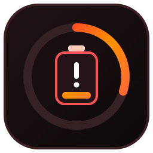
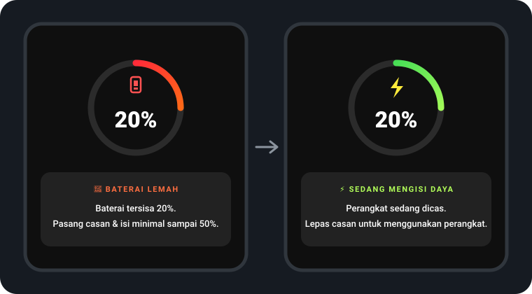
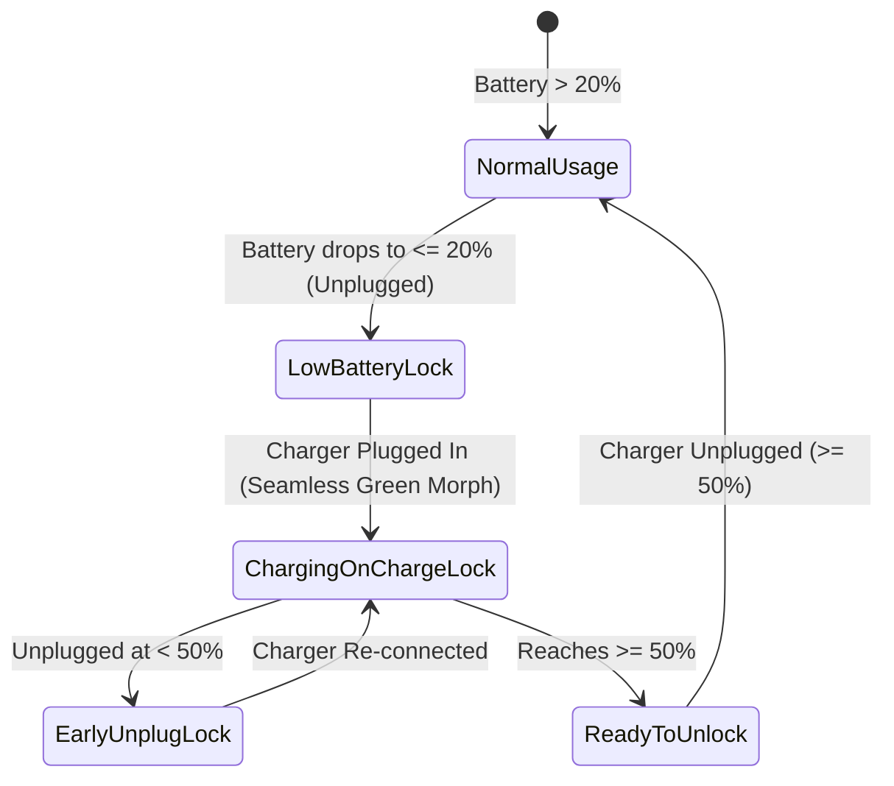

<p align="center">
  
</p>

<h1 align="center">BatteryLock</h1>

<p align="center">
  <b>Child-safe Android low-battery guard that locks the screen at &le; 20% and enforces charging up to &ge; 50% — with seamless visual handoff to ChargeLock and remote parent override via Google Family Link.</b>
</p>

<p align="center">
  
  
  
  
  
</p>

---

## Overview

**BatteryLock** protects children's tablets and phones from deep-discharge battery wear and enforces healthy charging habits. When battery level drops to **20% or below**, BatteryLock immediately locks the screen with a full-screen prompt instructing the child to plug in the charger.

To prevent children from unplugging the charger at `21%` just to keep playing, **BatteryLock** persists a hysteresis lock (`DeviceProtectedStorage`) that keeps the device locked whenever unplugged until the battery reaches **at least 50%**.

> **Companion Ecosystem**: Built as a sibling APK to [**ChargeLock**](https://github.com/Ravizikrillah/ChargeLock) so parents can independently toggle/block **BatteryLock** remotely in **Google Family Link** (e.g., while traveling without a charger) while keeping **ChargeLock** active.

---

## Seamless Screen Handoff (`≤ 20%` → Charging → `≥ 50%`)

<p align="center">
  
</p>

---

## Key Features

- **Smart `20% → 50%` Hysteresis State Machine (`BatteryLockState`)**:
  - **Trigger (`≤ 20%`)**: Activates mandatory charge lock (`mustChargeUntilTarget = true`), persisted in `DeviceProtectedStorage` across reboots.
  - **Anti-Cheat Early Unplug (`21% – 49%`)**: If unplugged before reaching `50%`, immediately re-locks with *"⚠️ PENGISIAN BELUM 50%"*.
  - **Release (`≥ 50%`)**: Clears mandatory lock flag; once unplugged at `50%+`, the device unlocks cleanly to the Home screen.

- **Zero-Flicker Color Morph & Handoff to [ChargeLock](https://github.com/Ravizikrillah/ChargeLock)**:
  - Uses the exact same `#0F0F0F` obsidian canvas, `220dp` animated ring, and `54sp` typography as **ChargeLock**.
  - When a charger is connected at `≤ 20%`, **BatteryLock** smoothly animates its crimson-amber ring into ChargeLock's emerald-lime palette (`animateColorAsState`) and triggers `OPEN_LOCK` with `overridePendingTransition(0, 0)` — zero Home screen flash.

- **Remote Parental Override via Google Family Link**:
  - No secret PINs for kids to guess on-device.
  - Because **BatteryLock** is a standalone APK (`com.ravi.batterylock`), parents can remotely **Block** `BatteryLock` from the **Google Family Link** app on their own phone during travel emergencies, and **Unblock** it later (`MY_PACKAGE_UNSUSPENDED` auto-resumes monitoring).

- **Stealth Launcher Footprint**:
  - Uses `CATEGORY_INFO` + `excludeFromRecents="true"` — completely hidden from the Home Screen, App Drawer, and Recent Apps list.

- **Automatic Multi-Language Localization**:
  - Automatically follows the device's system language (`ACTION_LOCALE_CHANGED` + Android 13+ `localeConfig`) out-of-the-box: **English**, **Bahasa Indonesia**, **Bahasa Melayu**, **Japanese (日本語)**, **Korean (한국어)**, **Simplified Chinese (简体中文)**, **Arabic (العربية — RTL)**, and **Spanish (Español)**.

---

## State Machine & Architecture



---

## Quick Install & One-Command ADB Setup

```bash
# 1. Build Debug APK
./gradlew assembleDebug

# 2. Install APK
adb install -r app/build/outputs/apk/debug/app-debug.apk

# 3. Grant Overlay, Notification, & OEM Background Exemptions (Samsung One UI / Xiaomi / etc.)
adb shell appops set com.ravi.batterylock SYSTEM_ALERT_WINDOW allow
adb shell appops set com.ravi.batterylock RUN_IN_BACKGROUND allow
adb shell appops set com.ravi.batterylock RUN_ANY_IN_BACKGROUND allow
adb shell pm grant com.ravi.batterylock android.permission.POST_NOTIFICATIONS
adb shell dumpsys deviceidle whitelist +com.ravi.batterylock

# 4. Start Monitoring Service Immediately
adb shell am broadcast -a com.ravi.batterylock.WAKE_CHECK -p com.ravi.batterylock
```

---

## Project Structure

```text
app/src/main/
├── AndroidManifest.xml
├── java/com/ravi/batterylock/
│   ├── BatteryLockApp.kt         # Auto-starts foreground service when unsuspended
│   ├── BatteryLockState.kt       # Direct-boot safe 20% -> 50% hysteresis persistence
│   ├── BootReceiver.kt           # Boot, package update, & Family Link unblock receiver
│   ├── BatteryMonitorService.kt  # Real-time battery threshold monitor
│   ├── LockActivity.kt           # Full-screen Compose lock UI with seamless color morph
│   ├── MainActivity.kt           # Permission diagnostics & status screen
│   └── ui/theme/                 # Material 3 crimson/amber theme definitions
└── res/                          # Custom vector icons & zero-flicker lock theme
```

---

## Companion App

| App | Role | Family Link Control |
| :--- | :--- | :--- |
| [**ChargeLock**](https://github.com/Ravizikrillah/ChargeLock) | Locks device **while charging** until cable is unplugged | Keep **Always Allowed** |
| **BatteryLock** *(this repo)* | Locks device at **≤ 20%** until charged to **≥ 50%** | **Block** temporarily in Family Link during travel emergencies |

---

## License

Released under the [MIT License](LICENSE).
